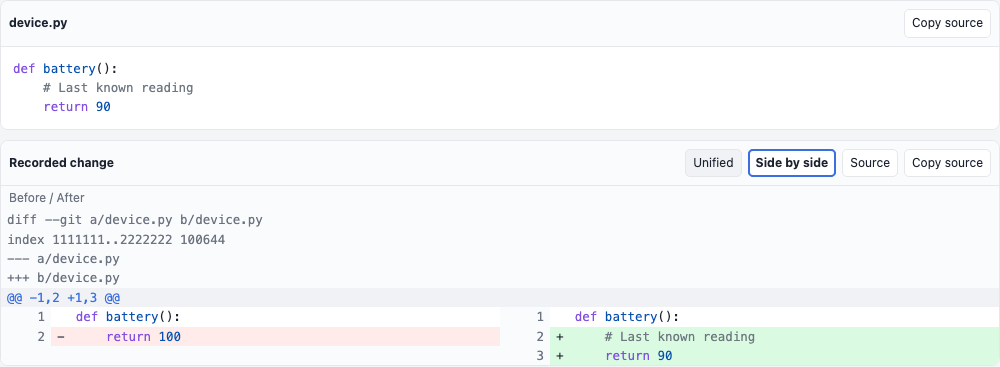

# Source code and diffs

Use language-tagged Markdown fences for code and `diff`/`patch` fences for
ordinary unified patches or short +/- fragments. The viewer provides one common
presentation in rich messages, existing report code/Markdown and SDK1.3 extension
components. It stays offline and read-only.

```python
def battery():
    return 90
```

````markdown
```diff
--- a/device.py
+++ b/device.py
@@ -1,2 +1,2 @@
 def battery():
-    return 100
+    return 90
```
````

Code blocks show explicit-language highlighting and Copy source. A diff offers
Unified, Side by side and Source. Short fragments have blank line numbers;
ordinary hunks display their supplied old/new numbers after count validation.
The last chosen diff view is the tab's default for newly rendered blocks. View
and copy controls never edit messages, touch files, run commands or apply patches.

Unsupported/malformed/binary/combined patches and inputs beyond65536 UTF-8 bytes
or2000 lines stay readable in Source view with an explanation. Highlighting is
bounded to16384 bytes per block and4096 characters per line. Unknown languages
remain plain text; raw source is not truncated. Clipboard failure reveals a
selectable source view instead of claiming success. Markdown/HTML code content
follows ordinary reader newline parsing; direct component source copy preserves
its supplied text and line endings.

<picture>
  <source media="(prefers-color-scheme: dark)" srcset="images/source-diffs-dark.png">
  
</picture>

The image isolates the same shared component used inside the board.

Existing report `code-block` schema is unchanged. Use a filename-like title for
language inference, or report Markdown for explicit language/diff fences.
SDK1.3 adds `code` and `diff` drawing nodes with required `text` and `language`
fields (literal or existing bindings), at most32768 code points and40 language
characters, within ordinary64KiB worker output. No new permissions are granted.
Existing SDK1.0/1.1/1.2 packages remain compatible.

See the canonical [portable source presentation contract](https://github.com/sloik/agent-file-board/blob/main/docs/SOURCE-CODE.md).
An offline copy is at `vendor/agent-file-board/docs/SOURCE-CODE.md`. Examples are
`vendor/agent-file-board/examples/source-code/` and
`vendor/agent-file-board/examples/extensions/source-review.afb-plugin.json`.
The package has both renderer modes; only its selected worker requires exact
browser-local approval. Source and filename labels are inert text.
